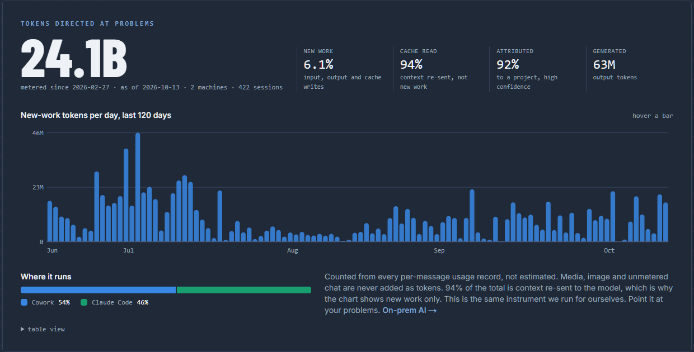

# token-dashboard

Count what your AI coding sessions actually cost, attribute it to the projects you were working on,
and render one self-contained HTML page. Stdlib only. No pip install, no server, no cloud.



Built by [Specialized Projects Group](https://www.specializedprojectsgroup.com) to run our own
operation first. The public projection of our instance is on the
[home page](https://www.specializedprojectsgroup.com); this repo is the pipeline behind it.

## What it does

- **Reads Claude Code transcripts** (`~/.claude/projects/**/*.jsonl`) and, if present, Cowork's
  session transcripts, and writes every per-message `usage` record into a SQLite store (`events.db`).
- **Attributes each session to a project** by the files its tools touched, using a longest-prefix map
  you control (`projects.csv`). Never by working directory, which carries no signal.
- **Tags outcomes** from a session-title prefix: `DONE` shipped, `DEAD` abandoned, `LESSON` salvaged.
- **Renders `dashboard.html`**: totals, new work versus re-sent context, attribution coverage, by
  project, by purpose, by outcome, by surface, by day.
- **Exports a public projection** (`export_public.py`): aggregates only, no names, for a website.

Every number is counted from a usage record, not inferred. The design principle the whole thing
rests on: **an undifferentiated total measures nothing.** Roughly nine tenths of a typical total is
cache read, context re-sent to the model, so the dashboard never shows a headline without the
new-work share and the attribution coverage next to it.

## Run

```
python extract.py          # ingest new or changed transcripts (incremental, idempotent)
python render.py           # write dashboard.html
```

First run: copy `projects.example.csv` to `projects.csv` and put your own path prefixes in it.
Longest prefix wins, so order does not matter.

After editing `projects.csv`:

```
python extract.py --reattribute
```

Re-derives project, purpose and outcome for every session without re-reading a transcript.

### Keep it current without thinking about it

`tally.py` is a hook entry point: debounced, single-flight, silent (logs to `tally.log`). Wire it
as a Claude Code `Stop` hook in `~/.claude/settings.json` and the store updates after every turn:

```json
{ "hooks": { "Stop": [ { "hooks": [ { "type": "command", "command": "python C:/path/to/token-dashboard/tally.py", "async": true } ] } ] } }
```

### Two machines

Each machine exports; one machine merges and renders. Attribution happens before export, so each
machine needs its own `projects.csv`.

```
python extract.py --machine BOX-B --export /shared/usage_BOX-B.csv.gz     # on the second machine
python extract.py --import /shared/usage_BOX-B.csv.gz && python render.py  # on the merging machine
```

Set `TOKEN_DASHBOARD_IMPORT` to the drop file's path and `tally.py` imports it automatically whenever
it changes.

### Public projection

```
python export_public.py --days 120     # writes public.json
```

Aggregates only: totals, shares, session and machine counts, a zero-filled daily series, and the
split by surface. No project, session, title or path ever leaves the store.

## Files

| | |
|---|---|
| `extract.py` | transcripts to `events.db`, attribution, export and import |
| `render.py` | `events.db` to `dashboard.html` |
| `export_public.py` | `events.db` to `public.json` |
| `tally.py` | the hook: extract then render, debounced |
| `claude_export.py` | optional: ingests a claude.ai data export as activity (no token fields exist in it, so it is never counted as tokens) |
| `projects.example.csv` | the shape of the attribution map |

`events.db`, `dashboard.html`, `public.json`, `tally.log` and your real `projects.csv` are gitignored.

## Limits, stated rather than hidden

- Claude Code and Cowork transcripts only. No claude.ai web, no other providers.
- Outcome coverage is partial unless you tag session titles. The dashboard states coverage on its face.
- Media are not token-denominated and are never added to a token total.
- Token share is not a proxy for working time. Any public use of these numbers should say so.

MIT. Specialized Projects Group, Inc.
